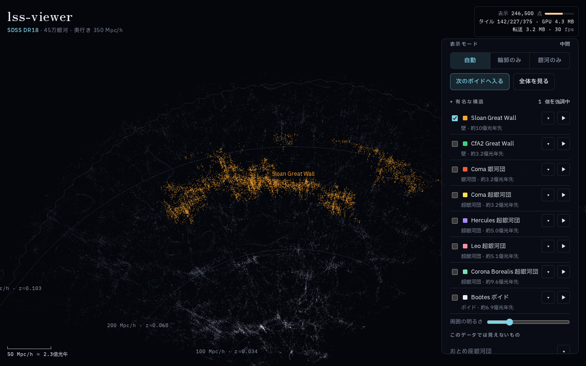

## はじめに

元々天文系に興味があり、最近はYouTubeで宇宙系の動画をよく見ていました。

その中で宇宙の大規模構造の話があったのですが、2Dの図だと、立体的にどうなっているのかイメージが湧きにくいです。

そこで、オープンなデータを使って可視化しました。

デモはインストールなしで、ブラウザからそのまま見られます↓

https://coxless.github.io/lss-viewer/

コードはこちら

https://github.com/Coxless/lss-viewer


*銀河データ：Sloan Digital Sky Survey（画面右上の fps はソフトウェア描画で撮影したときの値です）*

## lss-viewerとは

lss-viewer は、SDSS の分光観測で得られた銀河を3D表示する Web ビューアです。

- SDSS DR18 の銀河 445,900 個を、地球から約16億光年先（350 Mpc/h）まで表示
- ドラッグで回転、ピンチやホイールで拡大縮小
- 有名な構造（Sloan Great Wall など）を色付きで強調し、解説と出典を表示
- 配信は静的ファイルだけで、GitHub Pages で動く

## 有名な構造を探す

パネルの「有名な構造」にチェックを入れると、その領域の銀河に色が付きます。▶ を押すと、見やすい視点までカメラが飛びます。


*銀河データ：Sloan Digital Sky Survey*

視点と強調中の構造は URL に入るので、そのまま共有できます。たとえば次の URL は、上の画像に近い視点で開きます。

https://coxless.github.io/lss-viewer/#v=-219.76,27.67,11.13,-0.1253,1.52,449.06&s=sgw

一覧には14個の構造を登録していて、今のデータで見えるのは8個です。残りの6個は、見えない理由と一緒に表示しています。

| 構造 | 表示 | 理由 |
|------|------|------|
| Sloan Great Wall、Coma 銀河団、Boötes ボイドなど8個 | 見える | 領域の50%以上が観測範囲に入っている |
| おとめ座銀河団 | 見えない | 近すぎる |
| Shapley 超銀河団、Laniakea、Perseus-Pisces 超銀河団 | 見えない | 観測範囲の外にある |
| BOSS Great Wall、Hercules–Corona Borealis Great Wall | 見えない | 遠すぎる |

※ 領域は論文などの値をもとにした目安で、厳密な所属を示すものではありません。

また、銀河団が視線方向に伸びて見える「神の指」は補正していないので、Coma 銀河団は細長く見えます（ちなみに、そんな現象があるんだということをこれを作っていて初めて知りました）。

## 工夫した点

Wasm にも興味があったので、処理は Rust で書きました。重い処理は事前に CLI で済ませ、ブラウザでは CSV やしきい値の処理に Wasm を使っています。

```text
                    ┌─ 事前処理（一度だけ）────────┐
SDSS の CSV ───────▶│ lss-viewer-cli (Rust)        │
VAST のカタログ ───▶│ 座標変換 → 八分木 → 密度格子 │──▶ 静的ファイル
                    │ → ボイドの輪郭メッシュ       │
                    └──────────────────────────────┘
                    ┌─ ブラウザ ───────────────────┐
静的ファイル ──────▶│ Worker：取得、デコード       │
（HTTP Range）      │ Worker：lss-viewer-wasm      │◀── 手元の CSV
                    │ Main  ：WebGL2 描画、LOD選択 │
                    └──────────────────────────────┘
```

### 間引いても泡の形を消さない

点群のLODといえば [Potree](https://github.com/potree/PotreeConverter) が有名で、八分木と Range 取得の設計はこれを参考にしました。ただ、既定のポアソンディスク抽出は点を均一に並べるので、銀河の集まり方そのものを消してしまいます。

大規模構造を見たいのに、これでは本末転倒です。そこで、最初に全銀河をシャッフルし、各ノードが自分の範囲の先頭 K 個（4096個）を持ち、残りを子ノードへ順序を保ったまま渡すようにしました。

```rust
/// Fisher-Yates with a seeded stream.
pub fn shuffle(galaxies: &mut [Galaxy], seed: u64) {
    let mut rng = ChaCha8Rng::seed_from_u64(seed);
    for i in (1..galaxies.len()).rev() {
        let j = (((rng.next_u32() as u64) * (i as u64 + 1)) >> 32) as usize;
        galaxies.swap(i, j);
    }
}
```

こうすると、どのノードの点もその領域の（ほぼ）一様ランダム抽出になるので、間引いても泡の形が残ります。

:::message
乱数の範囲への変換は棄却ステップを省いた簡易版なので、厳密にはごくわずかな偏りがあります。表示用途なので許容しています。
:::

### 1銀河8バイトにする

座標はノードの中心からの相対値にして、int16 に量子化しています。属性（種別と明るさ）も含めて、1銀河は8バイトです。

```text
int16 x, y, z, attr
位置 = center + q / 32767 * half
```

### ボイドの輪郭に偽の壁を作らない

銀河を格子に数えて密度場を作り、低密度の境界を Surface Nets で三角形メッシュにしています。ここで一番気を使ったのが、観測範囲の端です。

観測していない場所は銀河がないので、そのまま計算すると「ボイド」に見えてしまいます。すると、観測範囲の端でボイドを閉じる偽の壁ができます。そこで次のようにしました。

1. 距離が遠いほど銀河が減る分を、動径方向の選択関数（距離ごとに観測される銀河数の割合）で補正する
2. マスクで正規化した畳み込みで密度を求める
3. 範囲外のセルは数値で埋めず、専用の値（255）で区別する
4. 範囲外に接する頂点を含む三角形は描かない

輪郭に穴が開くことはありますが、観測していない場所に面を描くよりはよいと判断しました。範囲外から1セル以内に頂点がないことは、回帰テストで確認しています。

### 初回の転送量を1MB以下にする

最初の表示に必要なものだけを先に読み、残りは後から取得します。実際に、初回表示時の転送量は約1.0MBでした（冒頭のスクショ右上）。

| データ | 取得するタイミング |
|--------|--------------------|
| メタデータ、八分木の階層、輪郭メッシュ | 最初に丸ごと |
| 浅い階層の銀河タイル | 最初に HTTP Range で |
| 深い階層の銀河タイル | 拡大に応じて HTTP Range で |
| 密度格子 | しきい値を初めて動かしたとき |
| Wasm | CSV やしきい値の処理を初めて使うとき |
| VAST のメッシュ | 表示をオンにしたとき |

### 実装中に気づいたこと：圧縮と部分取得の相性

銀河のデータ（`points.bin`）は、ファイル全体をダウンロードせず、「何バイト目から何バイト目まで」と範囲を指定して必要な部分だけ取得しています（HTTP の Range リクエスト）。

一方、GitHub Pages はファイルを gzip で圧縮して送ることがあります。この2つを組み合わせると困ったことが起きます。

curl で試したところ、`Accept-Encoding: gzip`を付けて範囲を指定すると、元のファイルではなく、圧縮した後のデータから指定した範囲が切り出されて返ってきました。

| 送ったリクエスト | 返ってきたもの | 全体のサイズ |
|------------------|----------------|--------------|
| 範囲指定＋圧縮OK | 圧縮後のデータの一部 | 3,481,070 バイト |
| 範囲指定＋圧縮なし | 元のファイルの一部 | 3,567,200 バイト（445,900個 × 8バイト） |

圧縮するかどうかはホスト側の設定次第で、こちらからは決められません。そこで、ホストの圧縮設定に左右されないように、範囲指定で取得するのは `points.bin` だけにしました。

輪郭メッシュと密度格子は範囲指定をやめて、あらかじめ自分で gzip 圧縮した `.bin.gz` を丸ごと取得し、Worker の `DecompressionStream` で展開しています。

### 既存のビューアを拡張しなかった理由

近いものとして、ブラウザで動く天文用の点群ビューア [Firefly](https://arxiv.org/abs/2207.13706) があります。

ライセンスが AGPL-3.0 で、静的ライブラリだけで2.6MBあり、ボイドの輪郭やスライスなどは追加で作る必要がありました。

ただ、一番の理由は自分で作ってみたかったからです。

## 今後の展望

- 銀河団などの高密度領域の輪郭レイヤー
- フィラメントの表示
- より遠くの天体の可視化

## データの出典

- 銀河：[Sloan Digital Sky Survey](https://www.sdss.org/) DR18
- ボイド：Douglass, Veyrat, BenZvi, [VAST void catalogs for SDSS DR7](https://doi.org/10.5281/zenodo.11043278), v1.3.1, [CC BY 4.0](https://creativecommons.org/licenses/by/4.0/)
  - 論文：[ApJS 265, 7](https://doi.org/10.3847/1538-4365/acabcf)
  - lss-viewer では、カタログの球の集まりを表示用のメッシュと一覧に変換しています

※ lss-viewer は SDSS や VAST の公式のツールではなく、各プロジェクトが推奨するものでもありません。

## おわりに

オープンなデータを活用していろいろやってみたいと、ずっと思っていました。

今までは実装のハードルが高かったのですが、Claude Codeと壁打ちしながらやることで、自分でもできるようになりました。

自分の手で宇宙の大規模構造を見てみると、2Dの図とはまた違った見え方がします。あと、ボイドって意外とたくさんあるんだなと思いました。

「この構造も見たい」「ここが間違っている」などがあれば、コメントをいただけると嬉しいです。フィードバックやPRも歓迎です。
